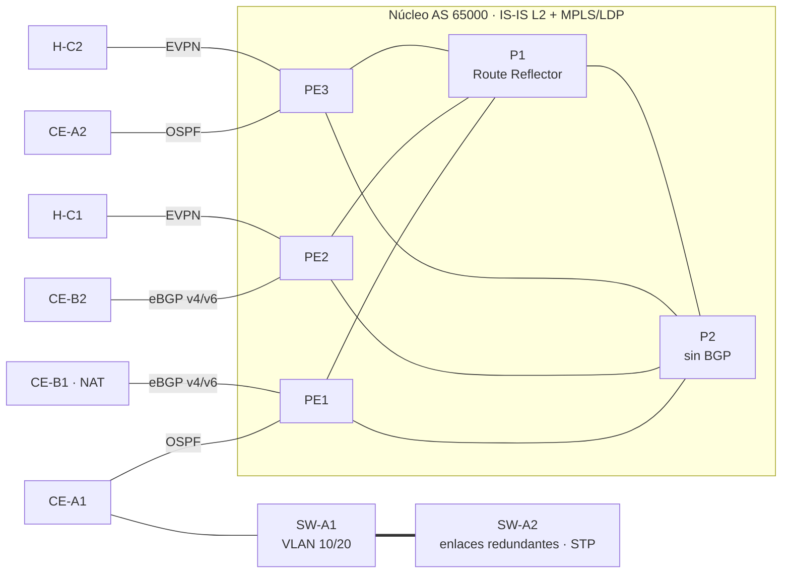

# SP-Lab · Red de proveedor IP/MPLS con L3VPN y EVPN

Laboratorio reproducible de una red de proveedor de telecomunicaciones: núcleo **IS-IS + MPLS/LDP**, **BGP** con route reflector, **L3VPN** (VPNv4/VPNv6) para dos clientes, **L2VPN con EVPN-VXLAN** para un tercero, y acceso de cliente con **VLAN, STP y NAT**. Se despliega con un comando, se valida con pruebas automáticas y está documentado como una red en operación: diseño, procedimiento de implementación, runbook de incidentes y registro de cambios.

**Tecnologías:** Containerlab · FRRouting 10.2 · Linux · IS-IS · OSPF · BGP / MP-BGP · MPLS · LDP · EVPN · VXLAN · IPv6 · Python · pytest · GitHub Actions

## Topología



18 nodos: 2 P, 3 PE, 4 CE, 2 switches de acceso y 7 hosts de prueba. Plan de direccionamiento completo en [docs/01-diseno.md](docs/01-diseno.md).

## Qué demuestra

| Área | Implementación en el laboratorio |
|---|---|
| Base L2/L3 | VLAN 802.1Q, troncales, STP con enlaces redundantes, enrutamiento entre VLAN, IPv4, NAT44 |
| Enrutamiento | IS-IS L2 dual-stack (núcleo), OSPF (PE-CE), BGP: iBGP con RR, eBGP, MP-BGP |
| MPLS | LDP sobre el núcleo; P2 opera sin BGP (solo conmutación de etiquetas) |
| VPN de red | L3VPN VPNv4 y VPNv6 (6VPE) con RD/RT por cliente; L2VPN con EVPN-VXLAN |
| IPv6 | IS-IS multi-topology, BGP4+ PE-CE, IPv6 extremo a extremo sin NAT |
| Políticas | Prefix-lists y route-maps en ambos lados del eBGP PE-CE |
| Operación | Health check, respaldo de configuraciones con diff, fallas simuladas, runbook |
| Calidad | 30+ pruebas automáticas (plano de control, servicios y resiliencia) + CI |

## Inicio rápido

Requisitos: Linux (o WSL2) con soporte MPLS en el kernel, Docker, [containerlab](https://containerlab.dev/install/) y Python 3.10+.

```bash
git clone https://github.com/Melany05AG/sp-mpls-lab.git && cd sp-mpls-lab
pip install -r requirements.txt
make deploy      # carga módulos del kernel y despliega los 18 nodos
make check       # estado del plano de control (IS-IS, LDP, OSPF, BGP)
make test        # pruebas de plano de control y servicios
make failover    # fallas simuladas y reconvergencia
make backup TICKET=CHG-0001
make destroy
```

Entrar a un router: `docker exec -it clab-sp-lab-pe1 vtysh`

## Documentación

| Documento | Contenido |
|---|---|
| [01 · Diseño](docs/01-diseno.md) | HLD/LLD: decisiones, direccionamiento, IS-IS NET, RD/RT, VNI, VLAN, limitaciones |
| [02 · Procedimiento de implementación](docs/02-procedimiento-implementacion.md) | MOP de despliegue y de un cambio, con verificación y reversión por paso |
| [03 · Runbook de incidentes](docs/03-runbook-incidentes.md) | Triaje por capas, severidades, 7 escenarios de falla y plantilla de reporte |
| [04 · Registro de cambios](docs/04-registro-cambios.md) | Bitácora y plantilla de solicitud de cambio |
| [05 · Plan de pruebas](docs/05-plan-pruebas.md) | Matriz de pruebas con resultado esperado |
| [06 · Hoja de ruta](docs/06-hoja-de-ruta.md) | Segment Routing, BFD, segundo RR, CGNAT, SRv6/RSVP-TE |

## Estructura

```
sp-lab.clab.yml          Topología (nodos y enlaces)
configs/<nodo>/frr.conf  Configuración de enrutamiento de cada nodo
configs/<nodo>/setup.sh  Kernel: MPLS, VRF, VXLAN, VLAN, puente/STP, NAT
automation/              lab.py (utilidades), health_check.py, backup_configs.py
tests/                   pytest: plano de control, servicios, fallas
scripts/                 Preparación del host y simulación de fallas
docs/                    Diseño, MOP, runbook, cambios, pruebas, hoja de ruta
```

## Limitaciones

FRRouting no implementa RSVP-TE y el kernel Linux no tiene plano de datos para VPWS/VPLS con LDP; por eso la L2VPN se hace con EVPN-VXLAN y RSVP-TE queda en la hoja de ruta con imágenes de fabricante. Detalle en [docs/01-diseno.md](docs/01-diseno.md#7-limitaciones-conocidas).

## Autora

Melany Arias Guadamuz · [LinkedIn](https://linkedin.com/in/melany-arias-guadamuz-aa98a62a0) · [Portafolio](https://Melany05AG.github.io)
