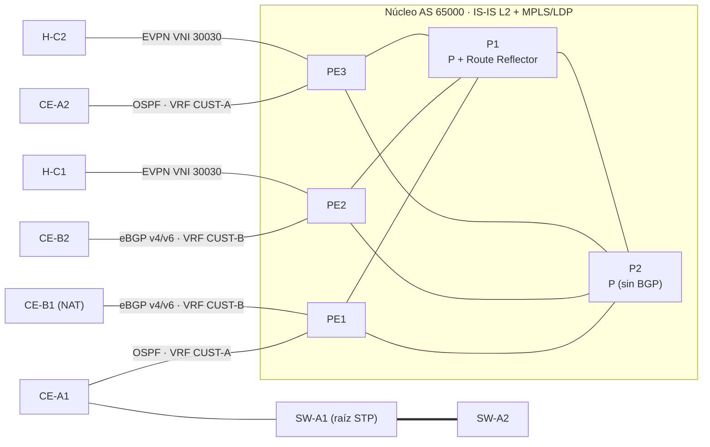

# 01 · Documento de diseño (HLD / LLD)

## 1. Objetivo

Simular la red de un proveedor de servicios que entrega tres servicios a clientes empresariales sobre un núcleo IP/MPLS común:

| Cliente | Servicio | Protocolo PE-CE | Sitios |
|---|---|---|---|
| CUST-A | L3VPN IPv4 | OSPF área 0 | Sitio 1 (PE1, dos VLAN), sitio 2 (PE3) |
| CUST-B | L3VPN IPv4 + IPv6 (VPNv4/VPNv6) | eBGP / BGP4+ | Sitio 1 (PE1, con NAT), sitio 2 (PE2) |
| CUST-C | L2VPN (EVPN-VXLAN) | Ninguno (mismo segmento L2) | PE2, PE3 |

## 2. Diseño de alto nivel

Decisiones de diseño:

- **IS-IS como IGP del núcleo.** Es el estándar en redes de proveedor: independiente de IP (transporta IPv4 e IPv6 en la misma instancia con multi-topology) y escala bien en un único nivel L2.
- **MPLS con LDP.** LDP asigna etiquetas a las loopbacks aprendidas por IS-IS. Esto permite que **P2 no ejecute BGP**: los P solo conmutan etiquetas.
- **Route reflector en P1.** Evita la malla completa de iBGP entre PE. Las familias VPNv4, VPNv6 y EVPN usan las mismas sesiones.
- **Redundancia.** Cada PE tiene doble conexión (P1 y P2) con métrica igual (10), así que hay ECMP y una ruta alterna ante falla de enlace o de nodo P.
- **6VPE.** El cliente B usa IPv6 transportado sobre el núcleo MPLS IPv4 (VPNv6 con next-hop IPv4).

## 3. Plan de direccionamiento

### 3.1 Loopbacks e IS-IS

| Nodo | Rol | Loopback IPv4 | Loopback IPv6 | IS-IS NET |
|---|---|---|---|---|
| P1 | P + RR | 10.255.0.1/32 | 2001:db8:ffff::1/128 | 49.0001.0102.5500.0001.00 |
| P2 | P | 10.255.0.2/32 | 2001:db8:ffff::2/128 | 49.0001.0102.5500.0002.00 |
| PE1 | PE | 10.255.0.11/32 | 2001:db8:ffff::11/128 | 49.0001.0102.5500.0011.00 |
| PE2 | PE | 10.255.0.12/32 | 2001:db8:ffff::12/128 | 49.0001.0102.5500.0012.00 |
| PE3 | PE | 10.255.0.13/32 | 2001:db8:ffff::13/128 | 49.0001.0102.5500.0013.00 |

El System ID se deriva de la loopback (10.255.0.11 → 010.255.000.011 → 0102.5500.0011), lo que facilita identificar el nodo en `show isis database`.

### 3.2 Enlaces del núcleo (/31, punto a punto)

| Enlace | Subred | Extremo A | Extremo B |
|---|---|---|---|
| P1 eth1 – P2 eth1 | 10.0.0.0/31 | P1 .0 | P2 .1 |
| PE1 eth1 – P1 eth2 | 10.0.0.2/31 | PE1 .2 | P1 .3 |
| PE1 eth2 – P2 eth2 | 10.0.0.4/31 | PE1 .4 | P2 .5 |
| PE2 eth1 – P1 eth3 | 10.0.0.6/31 | PE2 .6 | P1 .7 |
| PE2 eth2 – P2 eth3 | 10.0.0.8/31 | PE2 .8 | P2 .9 |
| PE3 eth1 – P1 eth4 | 10.0.0.10/31 | PE3 .10 | P1 .11 |
| PE3 eth2 – P2 eth4 | 10.0.0.12/31 | PE3 .12 | P2 .13 |

En IPv6, IS-IS forma adyacencias con direcciones link-local; los enlaces no necesitan direcciones globales.

### 3.3 Enlaces PE-CE

| Enlace | VRF | IPv4 | IPv6 |
|---|---|---|---|
| PE1 eth3 – CE-A1 eth1 | CUST-A | 172.16.1.0/30 (PE .1, CE .2) | — |
| PE3 eth3 – CE-A2 eth1 | CUST-A | 172.16.1.4/30 (PE .5, CE .6) | — |
| PE1 eth4 – CE-B1 eth1 | CUST-B | 172.16.2.0/30 (PE .1, CE .2) | 2001:db8:100:1::/64 (::1, ::2) |
| PE2 eth3 – CE-B2 eth1 | CUST-B | 172.16.2.4/30 (PE .5, CE .6) | 2001:db8:100:2::/64 (::1, ::2) |

### 3.4 Redes de clientes

| Cliente / sitio | Red | Puerta de enlace | Host de prueba |
|---|---|---|---|
| CUST-A sitio 1, VLAN 10 | 10.10.10.0/24 | CE-A1 eth2.10 (.1) | H-A10 (.10) |
| CUST-A sitio 1, VLAN 20 | 10.10.20.0/24 | CE-A1 eth2.20 (.1) | H-A20 (.10) |
| CUST-A sitio 2 | 10.10.30.0/24 | CE-A2 eth2 (.1) | H-A30 (.10) |
| CUST-B sitio 1 (privada) | 192.168.50.0/24, 2001:db8:b1::/64 | CE-B1 (.1 / ::1) | H-B1 (.10 / ::10) |
| CUST-B sitio 1 (pool NAT) | 198.51.100.1/32 | loopback CE-B1 | — |
| CUST-B sitio 2 | 198.51.100.128/25, 2001:db8:b2::/64 | CE-B2 (.129 / ::1) | H-B2 (.130 / ::10) |
| CUST-C (L2) | 10.30.0.0/24 | — | H-C1 (.1), H-C2 (.2) |

Se usan rangos de documentación (RFC 5737, RFC 3849) y privados (RFC 1918).

## 4. Servicios VPN

### 4.1 Distinguidores y destinos de ruta

| VRF | Tabla kernel | RD | RT import/export | PE |
|---|---|---|---|---|
| CUST-A | 10 | 65000:101 (PE1), 65000:103 (PE3) | 65000:100 | PE1, PE3 |
| CUST-B | 20 | 65000:201 (PE1), 65000:202 (PE2) | 65000:200 | PE1, PE2 |

Se usa un RD distinto por PE para que el route reflector no oculte rutas de sitios con prefijos iguales (útil cuando un sitio tenga doble conexión).

### 4.2 EVPN

| Servicio | VNI | RT | VTEP |
|---|---|---|---|
| CUST-C | 30030 | auto (65000:30030) | PE2 10.255.0.12, PE3 10.255.0.13 |

Los VTEP se descubren con rutas EVPN tipo 3 (IMET) y las MAC se anuncian con rutas tipo 2, sin inundación por aprendizaje en el plano de datos (`nolearning`). El tráfico VXLAN entre loopbacks viaja sobre los LSP de LDP.

### 4.3 CUST-A: OSPF como PE-CE

El PE redistribuye BGP en OSPF y OSPF en BGP dentro de la VRF. En el CE, las rutas del sitio remoto aparecen como externas (E2), porque FRR no implementa domain-id ni sham-link. En un proveedor real se valoraría usar el mismo domain-id para que aparezcan como inter-área.

### 4.4 CUST-B: eBGP con políticas

- **PE:** prefix-lists de entrada que solo aceptan el bloque asignado al cliente (198.51.100.0/24, 2001:db8:b0::/44). Protege la VRF de anuncios erróneos.
- **CE:** prefix-lists de salida que solo anuncian sus propios prefijos. La LAN privada 192.168.50.0/24 nunca sale del sitio.
- **NAT44 (PAT) en CE-B1:** 192.168.50.0/24 → 198.51.100.1. IPv6 viaja extremo a extremo sin traducción.
- Cada sitio tiene su propio AS (65001, 65002), así que no hace falta `as-override` ni `allowas-in`.

## 5. Acceso de cliente (CUST-A sitio 1)

| Equipo | Puerto | Modo | VLAN |
|---|---|---|---|
| SW-A1 | eth1 → CE-A1 | Troncal 802.1Q | 10, 20 |
| SW-A1 | eth2 → H-A10 | Acceso | 10 |
| SW-A1 | eth3, eth4 → SW-A2 | Troncal (redundante) | 10, 20 |
| SW-A2 | eth3 → H-A20 | Acceso | 20 |

SW-A1 es el puente raíz de STP (prioridad 4096). Con dos troncales paralelas hacia SW-A2, STP bloquea una para evitar el lazo. El puente Linux implementa STP 802.1D (un solo árbol para todas las VLAN); RSTP/MSTP requiere `mstpd` (ver hoja de ruta).

## 6. MTU

Containerlab crea los enlaces con MTU 9500, suficiente para la etiqueta MPLS (4 bytes por etiqueta) y la cabecera VXLAN (50 bytes) sin fragmentar las tramas de 1500 bytes de los clientes.

## 7. Limitaciones conocidas

| Tema | Situación | Alternativa |
|---|---|---|
| RSVP-TE | FRRouting no lo implementa | Imágenes de fabricante (Cisco XRd, Juniper vJunos, Nokia SR OS) — ver hoja de ruta |
| VPWS/VPLS con LDP | El kernel Linux no tiene plano de datos para pseudowires | L2VPN con EVPN-VXLAN |
| OSPF PE-CE como externas | Sin domain-id ni sham-link en FRR | Documentado en 4.3 |
| STP 802.1D | El puente Linux no hace RSTP de forma nativa | `mstpd` |
